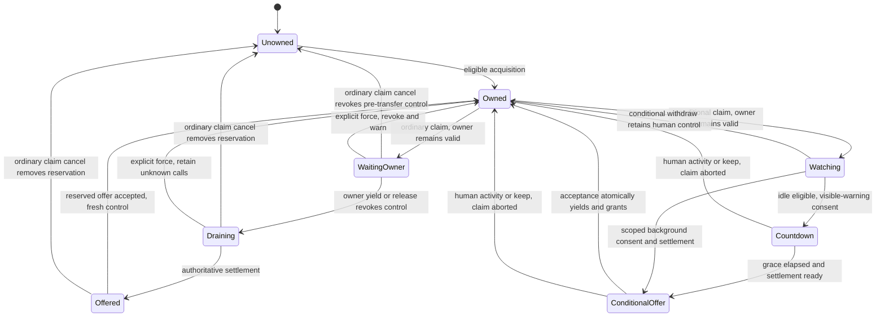

# PTY control wire contract — revision 1

Status: normative capability contract implemented in the isolated e03 Build. Ownership/native slices e03s01–04 passed their recorded checks; the integrated Codex broker and first complete-broker acceptance remain failing. Transport stays amux API v1. [ADR 0001](../adr/0001-cooperative-pty-ownership.md) defines cooperative ownership; [ADR 0002](../adr/0002-capability-control-interface.md) selects capabilities. This contract supersedes illustrative wire spellings in the earlier [Interface comparison](../tech-architecture/pty-control-interface-designs.md), not those accepted decisions. Actual commands, limits and failures are recorded in [Build evidence](../verifications/e03-integration-build.md).

Machine-readable shapes: [schema](pty-control.schema.yaml). Executable validation data: [examples](pty-control.examples.yaml). The schema checks message shape and role tags, not actual handle possession, freshness, state transitions or harness settlement.

## 1. Envelope, scope and authority

Requests are bounded newline-delimited JSON objects with `version: 1`, a closed `op`, and optional `persistent` (default false). Success is `{version:1, ok:true, result:...}`; failure is `{version:1, ok:false, error:{code,message}}`. Existing framing limits and explicit event-gap behavior remain. Every primitive returns after bounded local state work; none waits for owner cooperation, a timer, harness settlement or notification delivery.

There are three new top-level operations: `controller-create`, `ownership-claim`, `control-handle`. Existing `input` and `execute` gain a required `control` capability. Other existing observation, integration and topology operations are not redefined by this schema. A harness-specific structured-action schema is not invented here; supported agent mutations must pass through this same admission rule and additionally validate their live harness/session/request identity.

A handle is exactly `{kind,ref}`. `kind` is `controller`, `control`, `claim` or `offer`; `ref` is an opaque, daemon-minted, nonempty string. Clients do not parse it. The daemon binds each reference to its actual kind, controller, PTY lifetime, ownership generation and applicable claim/offer revision. Changing JSON tags or copying diagnostic metadata cannot change those bindings. References/claim IDs are never reused across target lifetimes. Daemon restart or PTY replacement cannot revive old authority.

Public snapshots/events expose controller IDs, claim IDs and observations, **not usable handle references**. Private controller/claim inspection returns only that controller's capabilities. This is same-user coordination, not a security sandbox or a generic capability-delegation framework.

`ControllerHandle` is a registration/recovery credential, not PTY input authority. Every native attachment has its own controller; an external controller registers once and reuses its credential across one-shot calls. Only a current `ControlHandle` authorizes input. `ClaimHandle` is pending intent; `OfferHandle` is a ready, reserved proposal, never input authority. Handle issuance is transition-time work, not per-key work.

Stable terminal IDs identify current PTY lifetimes; selectors/names may be resolved through existing observation calls, but mutation targets use returned IDs. Public `ownership.observed` is `{generation, reservation_id}`; `reservation_id` is the current public claim ID or null. Copy this receipt into compare-and-act operations. It is not authority and is unaffected by unrelated output/event sequence changes.

## 2. Requests and closed methods

All requests and results below are defined by the schema. Unknown methods/fields and wrong-kind handles fail; arbitrary `{method,args}` dispatch is not supported.

### Controller registration and observations

`controller-create {role,label}` returns `result.kind: controller-created` with `controller_id` and a `ControllerHandle` whose nested `kind` is `controller`. `role` is `external` or `attachment`. Attachment registration requires `persistent:true` and binds its view reporting to that native connection; identity remains distinct from the transport slot. Closing an external one-shot socket has no ownership effect. Closing a native connection marks its view departed, but does not release its lock or implicitly yield to another controller. A new attachment registers a new identity rather than replaying an uncertain registration.

`control-handle` with a controller capability permits:

- `read`: return current controls and claim summaries for this controller, plus `seq`. Recovery reuses current capabilities; it does not reacquire or repeat a mutation.
- `view {view:{serial,terminal,focused}}`: attachment-only, on its original native connection. `serial` strictly increases; delayed updates cannot overwrite newer focus/selection. `terminal` is the selected PTY ID or null; `focused` is true, false or unknown/null. A newly registered attachment has an unknown view until reported. Nesting preserves meaningful nulls through the current raw CLI's top-level null omission.
- `close`: delete registration and terminal claim history only when it owns no PTY and has no pending claim. Otherwise return `controller-busy`; closing never hides an implicit release/cancel.

The public ownership extension on existing `state`/`snapshot` is `ownership: PublicOwnership`, defined in the schema. It contains the compare receipt, owner, reservation, outstanding calls, activity/view revisions and attachment facts. Conditional reservations also carry non-authorizing policy, consent readiness and clock observations, so the owning attachment can render an external request without obtaining its private claim. The same ownership object appears in `ControlHandle.read` and public ownership events. `events` retains its existing sequence/gap/snapshot contract; it is not a private capability-recovery channel.

### Claim creation

`ownership-claim {controller,terminal,observed,mode,when?}`:

- `mode: cooperative` requires `when`. `when.kind: now` requests ordinary acquisition/handoff. `when.kind: human-idle` requires `idle_ms >= 0` and `warning_ms > 0`. `when.kind: views-backgrounded` requires an explicit `scope: owner|all`. Conditional requests target a particular native owner/generation, not whichever owner appears later.
- `mode: force` omits `when`. It compares the current ownership/reservation receipt, supersedes a matching old reservation if present, revokes old authority and grants the caller fresh control immediately. It needs no private handle from an abandoned requester. Stale observations fail rather than target a newer owner/reservation.

Ordinary acquisition on an unowned, unreserved, settled PTY grants fresh control. After cancelled takeover, the same prior controller may acquire fresh authority immediately while retaining its own outstanding work (`mode: resumed`); another controller still needs settlement or explicit force. Merely being unowned is not evidence of safety.

With another owner, an ordinary claim creates one reservation and returns a claim state. The current owner's token remains valid. A competing ordinary requester receives `control-reserved`; there is no hidden waiter queue or fairness/scheduling policy. An already-owning requester receives `already-owner` and can inspect its current capability instead of creating another claim. Conditional requests without a known native source owner fail `condition-unavailable`.

### Control methods

`control-handle` with a current control capability permits:

- `read`: return current ownership facts and this current capability; stale authority fails rather than claiming it still owns the PTY.
- `yield-to {claim_id}`: ordinary handoff only. Check exact owner, generation and reservation, revoke authority, reject undispatched old-generation work, and advance that reserved claim to settlement/offer. Return immediately.
- `consent-to {claim_id,view_serial,activity_revision}`: conditional reacquisition only, from the owning attachment's original native connection. This records **conditional consent, not immediate relinquishment**. The supplied revisions identify the facts used to draw/acknowledge this claim: reject a changed view serial with `stale-view`, changed activity with `stale-observation`, or no-longer-ready condition with `not-ready`/`condition-unavailable`. For idle reacquisition the native client sends it only after drawing the keep-control warning; the server starts the warning interval on receipt. For background reacquisition it acknowledges the current reported background facts. Ownership stays human until atomic conditional acceptance.
- `keep {claim_id}`: abort that conditional attempt and retain the same human control capability. It is not cancellation of an ordinary takeover.
- `activity`: record actual local human interaction consumed by the owning native client, without forwarding bytes. It requires that attachment's original connection. Actual native `input` admission records the same activity automatically; no extra activity request per key is required.
- `release`: revoke this authority without stopping work. If there is a pending ordinary transfer, preserve its reservation and advance settlement/offer; otherwise leave the PTY unowned. A conditional claim tied to the released source owner becomes `superseded` and its reservation is removed. Explicit hand-back can therefore release control and let the orchestrator make a fresh `now` claim without an inactivity delay. Release is the action for giving up an already-granted lock, not `ClaimHandle.cancel`.

Only original native connection input/activity counts as human interaction. A one-shot script borrowing the same controller's authority does not reset human inactivity by asserting a client-supplied source label. Input still requires valid authority regardless of origin. Internal terminal replies and settlement reports are separate daemon-classified progress, not a public input bypass.

### Claim and offer methods

`control-handle` with a claim capability permits:

- `read`: no ownership mutation. Return its phase, blockers and remaining delay where applicable. An offered phase returns the cached `OfferHandle`; granted state returns current `ControlHandle` only if this controller still owns that grant. A historical grant has `current:false` and no usable current control capability.
- `cancel`: ordinary takeover only, before grant. Invalidate pre-transfer authority even if the owner has not yielded, withdraw the reservation and leave no new owner. Retain outstanding calls. A granted/terminal claim cannot cancel newer ownership.
- `withdraw`: conditional reacquisition only, before grant. Withdraw the request/consent/offer while retaining human ownership. This is intentionally distinct from ordinary takeover cancellation.
- `force {observed}`: compare the current ownership/reservation and this live claim, then grant its requester fresh control without cooperation/settlement. Return forced mode plus the actual unresolved-call warning. A stale, withdrawn or superseded claim cannot force a newer transfer.

`control-handle` with an offer capability permits only `accept`. The daemon verifies its reserved requester, source lifetime/generation, current claim and offer revision, and required settlement/eligibility. Ordinary acceptance commits fresh control after owner yield. Conditional acceptance atomically consumes valid consent, revokes the still-current human capability and grants requester control. The two sides are never concurrent owners.

Duplicate or lost-response mutations are not replayed: a consumed offer fails `offer-consumed`; read the claim/controller to recover a committed grant. An older offer cannot become valid again after eligibility changes; a subsequently ready offer has a new reference.

## 3. Lifecycle and linearization

Every transition, authority admission, registration of dispatch and relevant activity/view update has a single per-PTY ordering point. Do not hold the global topology/event lock, PTY writer gate or ownership lock while waiting for the harness or a hook. Notifications describe transitions; delivery/acknowledgement is not a lock commit. After three seconds, progress identifies the awaited owner/consent and individual unsettled operations. No elapsed duration automatically grants control or cancels a turn.

At dispatch, an action is either rejected under invalid authority or recorded as forwarded before a revocation wins. Admission alone does not authorize later queue consumption. Undispatched old-generation entries are rejected/discarded; already-forwarded entries remain recorded until authoritative settlement or explicit unknown state. Cancellation, force, capability recovery and generation changes never erase that accounting.

Native input may use stream/batch watermarks rather than a heap-allocated record per keystroke. A PTY write barrier proves delivery ordering only. Structured agent operations need the harness's authoritative application/rejection acknowledgement; shell-source acceptance is distinct from command completion. Already-running turns, commands and tools continue producing effects after ownership changes. Safe handoff does not mean their completion or rollback. If the required application seam cannot be observed, expose `settlement-unavailable`/unknown and require explicit force; do not label silence, a socket write or a whole-turn finish as an application fence.

The [private fencing spike](../archive/spikes/SPIKE-pty-control-fencing.md) observed a native Enter buffered in a stopped TUI applying after an API-only ledger's false safe grant. Track the native input/application boundary too; question-resolution receipts do not certify unrelated native queues. The conforming response to an unproved native fence is unknown settlement, not a timed safe grant.

Subsequent user direction: defer further investigation of that incomplete-broker edge while completing the remaining specification, and revisit it during final complete-broker validation if still unresolved. This changes work ordering, not the safe-grant or explicit-force guarantees.

## 4. Human activity, countdown and attachment scope

The daemon uses a monotonic clock. Human activity starts at native ownership grant and advances on actual owning native key/paste/application-mouse input, local scroll/selection/search, or a consumed keep-control key. Output, report heartbeats, screen polling, focus notifications, resize and automatic active-terminal fallback are not human activity. Local UI gestures report activity for the owned selected PTY; non-owning observers cannot extend another owner's inactivity deadline.

Every conditional reservation requires a public `conditional` observation: immutable `when` (`human-idle` with `idle_ms`/`warning_ms`, or `views-backgrounded` with `scope`), `eligibility` (`eligible`, `ineligible`, `unknown`), `ready_for_consent`, `consent` (`awaiting`, `recorded`), and `clock`. Ordinary reservations must not include it. These are presentation facts, not claim/offer capabilities or permission to acquire. Read them through current ownership state, the owner's `ControlHandle.read`, or ownership events; never borrow the external requester's private handle.

`ready_for_consent` is true only for the current active claim when its condition is affirmatively eligible, consent is awaiting, and its original owning native connection has supplied the required current facts and can consent. False or unknown eligibility never permits consent. The owner draws/acknowledges that particular condition from this observation, capturing both its current native view serial and the displayed ownership `activity_revision`; it does not infer readiness from elapsed time, purpose or phase alone.

`clock.remaining_ms` is computed using the daemon's monotonic clock **at snapshot capture**, not a client deadline. Before idle consent, `clock.kind: idle` reports the time until idle eligibility (zero when eligible); the visible warning uses the configured `warning_ms` and starts only when consent is accepted. After consent, `clock.kind: warning` reports the actual remaining warning interval. It stays zero while settlement or explicit offer acceptance is still pending: expiry does not grant control. Background conditions always use `clock: {kind: none, remaining_ms: null}` and have no invented countdown.

Ownership events publish an updated snapshot when eligibility/readiness, consent or clock kind changes, including warning expiry. Reads refresh remaining time without requiring per-tick events. After an event gap, refresh the complete ownership snapshot; it contains the condition configuration and current clock without requester credentials. A native renderer may animate a local estimate from receipt of a fresh observation, but that estimate never accepts an offer or changes the input gate. Requester claim reads use this same public clock; there is no second private `remaining_ms` source.

Before warning starts, human activity resets the requested idle interval without creating another request. Once the visible warning starts, keep/activity aborts the conditional claim terminally, invalidates its offers, and retains the **same still-current human token**. While consent acknowledgement is pending, the native client explicitly sends `keep` for interaction with the visible warning; after consent is recorded, admitted human activity also aborts it atomically. This remains true while an offer waits for settlement/acceptance. The daemon never rearms it. Conditional consent is therefore checked/committed only at final acceptance; no revoke-and-revive trick is needed.

An original native connection must consume its pending human events before consenting and reporting view transitions. Consent validates the activity revision and view serial captured for its displayed observation; a physical/local interaction reported between drawing and consent cannot silently start an outdated warning, even with a zero idle interval. While that acknowledgement is pending, a warning keep key explicitly aborts the claim. The daemon orders only reports it has received; it cannot promise to observe an unreported physical key before a grant. On acceptance, atomically recheck owner/generation, consent, human activity revision, warning completion, attachment-view revision and settlement. If human activity wins, the claim aborts; if grant wins, subsequent input from old authority is gated and not replayed.

A view is foreground for a PTY when that attachment reports it selected and reports outer focus true. Opening the picker does not by itself background the still-selected PTY. `scope: owner` considers only the source owning attachment; `scope: all` considers all live registered native attachments, including newly joined views. Unknown first reports or focus block affirmative background eligibility. Departed attachments are not foreground, but departure is not owner consent; an absent owner cannot silently cooperate.

Every new view/focus/connection membership fact advances the relevant view revision. Newly joined/foreground/unknown views invalidate an incompatible background offer. If the scoped condition becomes false, consent and the offer are withdrawn and the same claim returns to watching; human activity/keep instead terminally aborts it. Missing facts block progress, not success. External policy chooses whether to request `owner` or `all`; amux does not infer the scope or resubmit an aborted request.

## 5. Race decisions

| Race | Required result at the daemon ordering point |
|---|---|
| Owner mutation versus cooperative request | Request alone preserves owner authority. The mutation may proceed if still current at dispatch. |
| Mutation versus yield/cancel/force | Mutation registers forwarding first, or revocation rejects it before dispatch. No untracked window; no replay. |
| Ordinary cancel versus offer acceptance | Exactly one commits. Cancel first gives no new owner; accept first makes later cancel fail without releasing the new control. |
| Force versus safe acceptance | Exactly one current observation/offer can win; the losing message cannot revoke the winner. |
| Another requester versus reserved offer | Ordinary acquisition cannot steal the gap. Explicit forced creation needs a matching current observation and supersedes the old claim. |
| Human input/keep versus conditional acceptance | Activity first aborts with existing token intact; grant first invalidates it and gates later input. |
| New/foreground/unknown attachment versus background acceptance | View update first retracts the offer; grant first is a committed transfer, not a retrospective rollback. |
| Older view serial versus newer focus report | Reject `stale-view`; never overwrite the newer facts. |
| Yield/accept/force/cancel from superseded claim | Reject stale/terminal intent; do not select a replacement claim automatically. |
| Wait timeout/socket loss versus committed accept | Claim/control survives; inspect private state. Timeout cannot prove failure or trigger cancellation. |
| Old call result after force or reacquisition | Update only its retained call record; do not alter current ownership or label it a new owner's action. |
| PTY exit/replacement/restart versus a cached capability | Reject invalid target/handle; never revive ownership from client copies. |

These are implementation acceptance obligations, not race tests already passed.

## 6. Results, events and errors

The schema defines private success variants: `controller-created`, `controller-state`, `control`, `claim-state`, `control-state`, and `transition`. They include `seq`; capabilities never ride in public events. `control` grant results distinguish `safe`, `forced`, and prior-controller `resumed`; a forced grant result always includes `warning.code: prior-calls-may-apply` and the actual unresolved records (possibly empty), never a fabricated safe acknowledgement. Later claim inspection reports `grant_mode` and current ownership/unsettled facts rather than repeating an old grant acknowledgement.

Public event kinds are `control-requested`, `control-progress`, `control-yielded`, `control-offered`, `control-granted`, `control-cancelled`, `control-withdrawn`, `control-aborted`, `control-call-settled`, and `control-view-changed`. Their existing `{seq,kind,terminal,data}` envelope carries current `PublicOwnership`, applicable public claim ID and operation-specific progress/call facts. The three-second progress event is not a new timer-based authority policy. Event gaps require snapshot/private inspection, not command replay or treating missing history as empty user input.

Requested/progress/offered/cancelled/withdrawn/aborted events require `data.claim_id`; progress also requires `data.blockers`. A grant event requires `data.mode`, including immediate acquisition with no claim. A call-settlement event requires `data.call_id` and `data.outcome`; an unknown outcome remains an unresolved blocker, not safe settlement. Yield/release and view-change events need no invented claim identity.

Normal watching/countdown/waiting/offered states are successful results. Errors retain existing `{code,message}` only; clients do not need error metadata. Relevant codes: `unsupported-version`, `invalid-request`, `stale-handle`, `wrong-handle-kind`, `controller-mismatch`, `target-ended`, `already-owner`, `control-reserved`, `stale-observation`, `wrong-claim-kind`, `claim-completed`, `not-ready`, `stale-offer`, `offer-consumed`, `stale-view`, `not-native-connection`, `condition-unavailable`, `settlement-unavailable`, `controller-busy`. Messages are diagnostic, not protocol. Typed local handling must preserve the wire code rather than parse arbitrary text. No error permits automatic retargeting or replay of a mutation.

`input` keeps existing text/bytes/key/paste semantics and limits; `execute` keeps source/queue and native shell-readiness semantics. Both require current `control`. Internal shell epoch/wake continuations bind to the originating submission's authority: they cannot dispatch new input after revocation merely because they arrive as `report`. Settlement/lifecycle reports may still account for old work, and genuine automatic terminal replies continue independently. No client-supplied protocol label bypasses ownership.

## 7. Client waiting and scope limits

Async submit returns a claim or actual granted control, not an exit-code promise. Read-only inspection does not accept an offer. A sync wrapper may read/events-wait/accept that same claim; it may block its own process, not the native event loop or a daemon primitive. An external `timeout`/SIGINT merely ends that waiter. Explicit cancellation on the next script line acts only on a still-pending ordinary claim; already-granted control requires explicit release. Unknown accept outcomes are recovered by private inspection, never repeated blindly.

Use existing `amux api` for the capability operations and concrete `agent-open`, `agent-inspect`, `agent-prompt`, `agent-answer`, `agent-permission` and `agent-interrupt` operations. Agent mutations additionally bind the current instance/session and applicable turn/item/provider request; a retained call receipt is not task completion or a proven native/API response winner. The ownership extension and native control UI now exist in the isolated Build. First acceptance is still blocked by the recorded live interaction failures and unknown native/application settlement; fixture and force-only results do not waive either gate. Build and bounded real-harness checks were separately authorized, not global daemon/config/auth changes, commit, merge, push or release.
