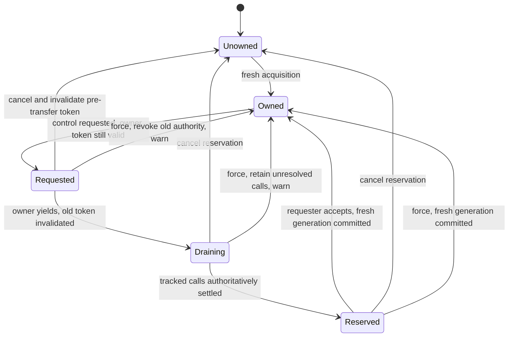

# Agent interaction: architecture exploration

Status: source-backed architecture and confirmed per-PTY cooperative ownership decision, with scoped Elaborate and e03 Plan quality gates passed. The normative wire/native contracts below define the locked design; explicit Build confirmation remains outstanding and no runtime implementation is claimed.

Current contract: [planning context](../planning-context.yaml). Runtime evidence: [private native/API spike](../archive/spikes/SPIKE-native-agent-interaction.md). Domain vocabulary follows the existing [amux design](DESIGN_PLAN_LATEST.md): project, workspace, terminal, shell context, execution and agent instance remain distinct.

## Scope and method

The forcing function is exclusive native/orchestrator control of each PTY: cooperative requests preserve the current owner until yield, while relinquishment, cancellation or explicit force invalidate prior authority. Safe grant must account for already-forwarded calls; force intentionally accepts their unresolved risk without cancelling work. This is not a general refactoring exercise.

Read-only exploration covered dispatch/transport and native input/presentation separately. Parent symbol queries used the ready Rust language server; source citations below were checked against current code. Existing tests were inspected, not executed. The installed `bp-churn-rank.sh --since 90.days --limit 20 src integrations` ranked `src/tui.rs` highest, followed by daemon/client, making the ownership paths concrete churn targets rather than speculative abstractions.

## 1. Daemon-side interaction ownership and dispatch

### Files and current behavior

- [daemon.rs:233–285](../../src/daemon.rs#L233-L285): `execute_source` preflights before taking the terminal input gate; immediate source execution holds that gate through a writer barrier and native shell acceptance. Queued execution and its epoch/wake continuation use different gate ownership to avoid deadlock.
- [daemon.rs:706–780](../../src/daemon.rs#L706-L780): native and external `input` share terminal-targeted requests without caller provenance or ownership tokens. Ordinary reports deliver outcomes; some `report` variants actively perform shell wake/epoch control. The operation name alone does not classify mutation versus observation.
- [daemon.rs:480–509](../../src/daemon.rs#L480-L509): command/recipe/OMP startup calls `execute_source` asynchronously after terminal publication, rather than entering dispatch's execute arm.
- [runtime.rs:289–335](../../src/runtime.rs#L289-L335) and [412–438](../../src/runtime.rs#L412-L438): the bounded writer queue contains bytes and an optional write-result sender. `input` success means enqueue; `input_confirmed` waits for `write_all`, not application by the child. A timeout does not retract an already-enqueued item.
- [integration.rs:201–294](../../src/integration.rs#L201-L294) and [450–494](../../src/integration.rs#L450-L494): agent reports describe lifecycle/root identity and observation freshness, not outstanding interaction calls or ownership. Expired reporting is unknown, not a drain acknowledgement.

### Problem

No existing Module owns the complete transition between valid authority, local dispatch registration, outstanding harness calls and safe/forced grant. A check at dispatch entry can become stale while waiting for another mutex. A terminal UUID, input epoch, lifecycle generation and ownership generation have different meanings.

A writer acknowledgement cannot prove safe takeover. Holding the global daemon mutex during a drain would also obstruct reports needed to settle work. Automatic terminal protocol replies must continue while human/automation input is gated; otherwise an apparently exclusive lock could stall the running native application.

### Deepening opportunity

Concentrate ownership transitions and outstanding interaction accounting in one daemon-owned PTY interaction ownership Module per live PTY, while retaining terminal transport and shell execution semantics in their existing Modules. Agent-targeted operations additionally check harness/session/request identity rather than creating an unrelated competing agent lock. Callers should not reconstruct whether a response means admission, forwarding, settlement, unknown outcome or safe ownership transfer.

This is a responsibility proposal, not a new generic Adapter framework or a proposed Interface. The existing OMP reporter is not a structured-control Adapter. A concrete supported harness path remains required; the Codex experiment does not count as a shipped second Adapter.

### Benefits

**Locality:** authority revocation, generation changes and in-flight accounting stop being facts each mutation caller must coordinate independently. **Leverage:** native and external callers get the same honest ownership outcome without learning writer/FIFO/report ordering. Tests can exercise revocation versus dispatch, safe drain versus unknown outcome and explicit force at the same Seam used by real callers.

Preserve the ZLE gate/epoch handshake, bounded/nonblocking terminal replies, independent PTY processing, event-gap reporting and existing process cleanup. Force is never implemented using `close`, Ctrl-C or process signalling.

## 2. Native interaction routing and ownership presentation

### Files and current behavior

- [tui.rs:62–112](../../src/tui.rs#L62-L112): `call`, `send_input` and input error handling use one synchronous persistent connection. Only four existing input error codes are recoverable; an unhandled ownership rejection would currently propagate out of the TUI.
- [tui.rs:795–887](../../src/tui.rs#L795-L887): drawing, transport calls and event reads happen sequentially. Native paste calls `call` directly, bypassing `send_input`; focus reports share `send_input` with real input.
- [tui.rs:890–912](../../src/tui.rs#L890-L912): literal-prefix forwarding is a separate input path. [1179–1223](../../src/tui.rs#L1179-L1223) distinguishes application mouse input from local scrolling, selection and copying.
- [tui/view.rs:33–85](../../src/tui/view.rs#L33-L85) and [477–486](../../src/tui/view.rs#L477-L486): the native body is edge-to-edge and unbordered; existing borders belong to chrome. Native sizing and mouse coordinates also depend on the three-row header in `tui.rs`, not only the shared geometry helper.
- [tui.rs:712–751](../../src/tui.rs#L712-L751) and [859–869](../../src/tui.rs#L859-L869): active terminal and focus are client-local. Daemon socket slots are not semantic view attachments, and the existing global detach generation is not a background observation.

### Problem

A lock check only in the usual key branch or `send_input` misses paste/literal-prefix paths and conflates application mouse input with viewing. It must not treat terminal protocol replies, agent output, resize or report heartbeats as human interaction.

A synchronous handoff request that waits for cooperation or drain on the TUI thread would prevent three-second progress updates and make force/cancel controls unusable during that wait. This is a direct control-flow consequence, not an observed implemented handoff bug: ownership does not exist yet.

One client's FocusLost does not prove the session is backgrounded in another attached client. Likewise automatic active-terminal fallback after removal is not intentional hand-back. Observation needs attachment scope; interpretation and reacquisition policy remain external.

### Deepening opportunity

Concentrate native interaction classification and takeover/countdown presentation so all input paths obey the same ownership state, while retaining local navigation, viewing and native rendering independently. Pending handover must remain interactive rather than turning into a blocking drain call on the event loop.

Prefer the existing chrome for the lock badge and border color. A new border around the native body would consume or overwrite terminal cells unless sizing, cursor, mouse and selection geometry change together; no such layout expansion is required merely to signal ownership.

### Benefits

**Locality:** no-replay, takeover confirmation, warning/countdown and recoverable lock errors have one native interaction decision point rather than separate key/paste/mouse exceptions. **Leverage:** the same visible state remains meaningful while output continues or the picker is open. Verification can drive real event sequences, not merely test byte encoders in isolation.

Keep the existing deep key/mouse codecs, validated screen deltas, wide-cell projection and bounded frame scheduling. The native transcript's optimistic-answer race remains a harness compatibility risk; chrome must not claim authoritative resolution from that echo alone.

## Existing Module Depth and deletion test

Scores are architectural judgments on existing Modules, not quality-gate percentages or scores assigned to unimplemented code.

| Existing Module | Depth (1–5) | Deletion test and concrete friction |
|---|---:|---|
| `Daemon::execute_source` | 2 | Removing it repeats gate/barrier rules in dispatch and startup callers. It earns its keep, but critical native acknowledgement and queued-wake knowledge lives elsewhere. |
| TUI `call` / `send_input` / `input_result` | 2 | Removing them repeats framing/timeout/error policy. They are not a complete input Seam: paste bypasses one helper and focus uses it. |
| `tui::run` | 3 | Removing it redistributes real attach/event behavior. Ownership adds pressure to an Implementation already mixing navigation, input, transport waits and presentation timing. |
| `view::draw` | 2 | Removing it moves meaningful rendering into callers. Its wide Interface requires callers to coordinate screen, surface, snapshot and many view-state arguments. |
| `runtime::Terminal` | 4 | Removing it distributes PTY/emulator/thread/process lifetime into callers. Preserve this Depth rather than turning it into an orchestration-policy Module. |
| Native surface, screen-delta and input codecs | 4 | Removing them duplicates validated reconstruction and terminal protocol knowledge. They are not refactoring targets for this feature. |

## Existing preservation evidence and missing verification

Inspected, not run in this exploration:

- `tests/shell_races.rs:103–132,232–259`: delayed queued wake must not follow typeahead into a foreground application; competing immediate submission must not deadlock the wake.
- `tests/acceptance.rs:345–457`: event transitions/gaps and noisy-PTY/slow-observer input isolation.
- `tests/runtime.rs:60–125,215–254`: real terminal mode/query/reply behavior and foreground input.
- `src/tui.rs:1269–1520`: native cells/deltas/cursor, keyboard/mouse encoding, selection and picker behavior.

These protect existing behavior; they do not prove ownership. Missing consumer-visible verification includes revoked calls racing dispatch, late outcomes after force, responsive pending controls, no replay across key/paste/mouse paths, countdown cancellation versus grant, and conflicting attachment focus observations. No permanent tests or mock-only ownership harness were added.

## Confirmed cooperative ownership decision

Opportunity 1 is the selected starting point; opportunity 2 displays and enforces the same authority facts. The user confirmed [cooperative per-PTY ownership](../adr/0001-cooperative-pty-ownership.md), including native-to-native handoff rather than an automation-only lock.

**Unowned does not mean settled.** Cancelling leaves no new owner and never revives the previous token. The prior controller can request fresh authority immediately; amux does not grant it automatically. Outstanding calls remain accounted for, so a different controller cannot mistake that availability for a safe drain. Delayed messages for cancelled or superseded transfers cannot change newer ownership.

An offered transfer is reserved for its requester; notifications and peer acknowledgement are not ownership commits. The three-second threshold exposes progress, not an automatic takeover deadline. Both native owners and orchestrators can cooperate, while explicit force bypasses their response without stopping the turn/process.

Cancelling a pending takeover is distinct from aborting an orchestrator's inactivity countdown: the latter retains human ownership and does not automatically retry. Reacquisition policy remains external.

The PTY lock serializes input authority; it does not make terminal-write completion a semantic application acknowledgement. Raw PTY transport quiescence and harness-confirmed structured settlement must remain distinguishable. The prior spike establishes neither a universal application fence nor a working handoff.

The user selected C, [control/claim/offer capabilities](pty-control-interface-designs.md), recorded in [ADR 0002](../adr/0002-capability-control-interface.md). Raw Interface plumbing takes priority over CLI porcelain; asynchronous claims and client-side waiting share the same nonblocking primitives. The normative [wire contract](../contracts/pty-control.md) defines exact messages, controller recovery, conditional consent and attachment-scoped activity/background linearization. Harness settlement and actual ownership behavior remain capability/proof gates; the confirmed cooperative timing and Interface model are not reopened.

[ADR 0003](../adr/0003-codex-first-agent-target.md) selects Codex local app-server/native TUI as the first implementation target; the [native UX contract](pty-control-native-ux.md) defines wrapper interactions and attachment lifetime. The user deferred the intentionally incomplete broker's native-buffer edge to final complete-broker validation if unresolved. The authorized [scoped design review](../verifications/agent-interaction-design-review.md) and [Plan quality gate](../verifications/e03-plan-review.md) passed; follow the [e03 capsule](../epics/e03-agent-interaction/PLAN.md) after explicit Build confirmation rather than repeating that experiment. Production acceptance remains unpassed.

## Exercised verification and gate

`cargo run -- --help` exited 0 and advertised the existing attach, generic request, input, execute, events, wait and detach commands. Clap parses help before daemon connection/startup. Only the help path was exercised; no live daemon, ownership UI or lock scenario was run or claimed.

The [private fencing follow-up](../archive/spikes/SPIKE-pty-control-fencing.md) exercised a limited broker with the real native/API thread: API-question drain to native control and non-cancelling force worked, but an API-only ledger failed to account for native Enter buffered in a stopped TUI. Native application/quiescence remains unproved; production ownership is unimplemented. The separately authorized Elaborate and Plan quality gates passed. Explicit Build confirmation is pending; Build/release remain unstarted. No Rust, TypeScript, shell implementation or import graph changed.
